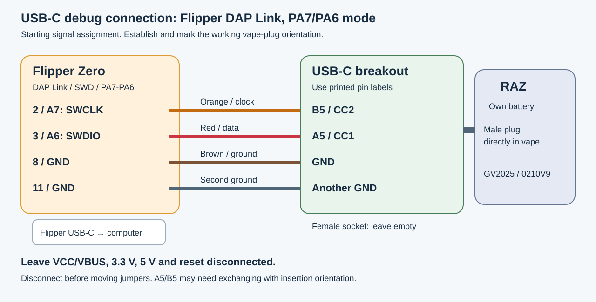
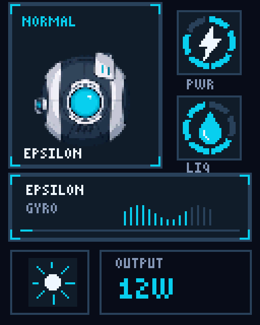
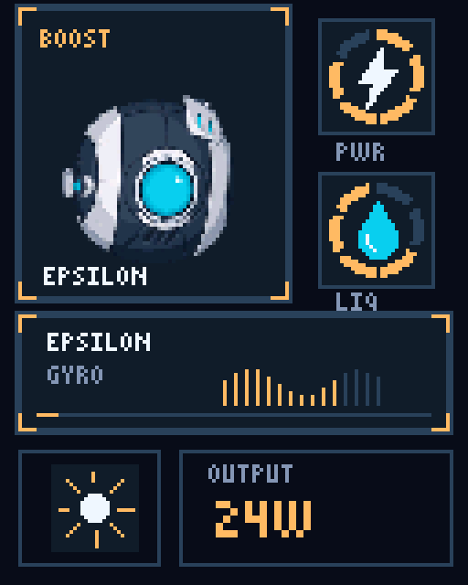
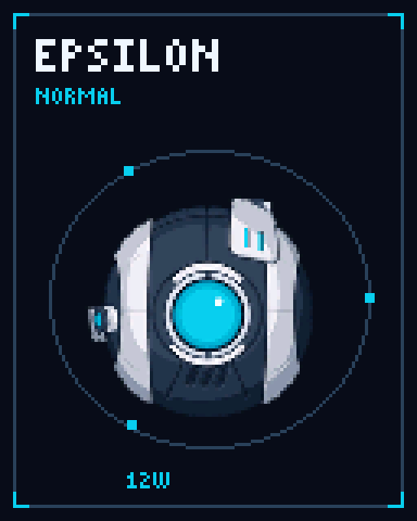

# Retheming a RAZ LTX display through USB-C with a Flipper Zero

## Replacing the graphics while keeping the original firmware

We replaced the settings-screen artwork and animations on an unopened RAZ vape using a Flipper Zero, a USB-C breakout, and OpenOCD. The existing MCU firmware continued to run the device. The changes went into its separate 4 MiB SPI graphics flash.

This repository illustrates the method with **Epsilon Gyro**, an original character theme with cyan Normal screens, amber Boost screens, all seven gauge stages, moving status strips, and separate bright/dim sun icons. The [186 PNG components and manifest](artwork/README.md) match the recovered image geometry and RGB565 contract.


*The Epsilon previews shown here were generated offline. After this guide's original one-device test, we installed and checked Epsilon on a second vape; see the [second-device addendum](SECOND-DEVICE.md). The original test and the second installation have separate evidence.*

This main walkthrough documents **the first device with the version screen `GV2025 / 0210V9`**, tested on October 18, 2026. The [addendum](SECOND-DEVICE.md) compares a second device captured and rethemed on October 19. The first unit's exterior matches the RAZ LTX 25K / DC25000 Punch Edition. We never opened either case, so PCB revisions, MCU part markings, display controllers, and flash package suffixes remain unverified. The addresses below belong to the first firmware capture; the product name or an SWD response alone does not establish compatibility.

## Third-device compatibility update

A third unit captured on October 28 has a substantially revised display implementation: a shared 54-frame puff sequence, 29-frame menu strips, a dedicated off-state charging screen with battery percentage, larger shared gauges and partial menu redraws. Its five-click-off transition also adds an explicit heater-stop/reset step. The inspected controls and duration-weighted liquid accounting remain consistent with the earlier firmware.

Read the [third-device firmware and feature comparison](THIRD-DEVICE.md) for function addresses, capture hashes, the new asset map and unresolved questions. **The earlier theme files and firmware helper addresses are not drop-in compatible with that revision.** The third device was backed up and analyzed without programming flash; it has not received the Epsilon theme. The first-device walkthrough below remains specific to its captured firmware.

## Where this work starts

The starting points were [ginbot86's ColorLCDVape-RE](https://github.com/ginbot86/ColorLCDVape-RE/blob/main/docs/KrazeHD7K-RazTN9000.md), [xbenkozx's RAZ-RE](https://github.com/xbenkozx/RAZ-RE), and [ImoverEngineering's Vaporware wiring guide](https://github.com/ImoverEngineering/Vaporware/blob/main/docs/WIRING.md). Those projects documented the hardware family, raw display assets, and the useful USB-C debug connection. Their authors deserve the credit for that foundation.

Our contribution is a capture-and-retheme method for this `0210V9` unit: catch its MCU while awake, use its own SPI read routine to recover the graphics flash, map the complete status screen as well as the animations, then run a sector writer from SRAM. We did not install an older model's replacement MCU firmware. The earlier TN9000 documentation describes a different display size and flash capacity; its image offsets cannot be transplanted to this unit.

## Equipment and wiring

The successful setup used:

- A Flipper Zero running [DAP Link](https://lab.flipper.net/apps/dap_link), in SWD mode with **PA7/PA6** selected.
- A USB-C male/female breakout with separate A5 and B5 header pins, jumper wires, and a second ground jumper.
- A Mac running OpenOCD **0.12.0** through `interface/cmsis-dap.cfg` at **100 kHz**.
- A continuity-capable multimeter to check the jumper connections while disconnected.

The computer connects to the Flipper's USB-C port. The breakout's **male plug** goes directly into the vape. The breakout's female socket stays empty. The vape runs from its own battery. Leave VCC/VBUS, 3.3 V, 5 V, and reset disconnected; these instructions do not use a charging connection.



| Signal | Flipper socket, PA7/PA6 mode | Breakout starting assignment | Wire used here |
| --- | --- | --- | --- |
| SWCLK | 2 / A7 | B5 / CC2 | Orange |
| SWDIO | 3 / A6 | A5 / CC1 | Red |
| Ground | 8 / GND | GND | Brown |
| Additional ground | 11 / GND | Another GND pin | Spare jumper |

The app's [GPIO-selection code](https://github.com/flipperdevices/flipperzero-good-faps/blob/dev/dap_link/dap_link.c#L125-L139) assigns PA7 to SWCLK and PA6 to SWDIO. Its alternate PA14/PA13 setting uses different sockets. Follow the selected app pinout, not the Flipper's own debug-pin labels.

**Plug orientation matters for this debug use of USB-C.** A5/B5 are the starting assignment; the two signals may need exchanging for the particular board and insertion orientation. Our final plug orientation was not photographed or marked. Establish repeatable reads, mark the working orientation, and keep it fixed. Disconnect both ends before changing jumpers, change one thing at a time, and keep the wires short and supported.

An ST-Link clone initially produced occasional debug-ID reads, sometimes during unplugging. The completed dump and theme write used the Flipper. Moving to another breakout GND and adding the second ground made button-triggered connections repeatable. That is an observation about this wiring, not proof of the original electrical fault. A steady continuity beep did not by itself establish a reliable SWD connection.

## Identify the target before using its firmware routines

Our captured identifiers were:

| Item | Observation |
| --- | --- |
| Version screen after a long button hold | `GV2025`, `0210V9` |
| SWD debug-port ID | `0x0BB11477` |
| Core reported by OpenOCD | Cortex-M0 r0p0 |
| Internal firmware capture | 65,536 bytes starting at `0x08000000` |
| Initial SP / reset vector | `0x20000DC8` / `0x080000D9` |
| External flash RDID, command `0x9F` | `85 60 16` |
| External capacity | 4,194,304 bytes, 32 Mbit |
| Display raster recovered from graphics and drawing calls | 128 × 160 pixels |

The SWD ID identifies the debug interface, **not the exact MCU model**. The internal firmware SHA-256 was:

```text
b8e274b63656f470ace0fe106c618a9963ca91306b999c1be5bd872e39606b11
```

The graphics chip's RDID plus SFDP matched the **Puya P25Q32SH family**. In particular, SFDP byte `0x32` was `F9`, and bytes `0x60..0x63` were `00 36 00 23`, matching the manufacturer's table. The [Puya datasheet](https://www.puyasemi.com/download_path/%E6%95%B0%E6%8D%AE%E6%89%8B%E5%86%8C/Flash/P25Q32SH_Datasheet_V1.8.pdf), pp. 92–96, supplies the identification and geometry reference. The physical package and full ordering code still require a chip marking. [Our captured SFDP response](evidence/flash-sfdp.txt) is included.

## Getting past the short wake window

The debug connection stopped responding when the vape slept. Repeatedly reconnecting and pressing the button was enough for short reads, but unsuitable for a full dump or write.

We analyzed two matching internal-firmware reads in Ghidra 12.1.4 using an ARM Cortex/Thumb language definition at `0x08000000`. A generic ARM disassembly had not decoded this Thumb-only firmware correctly. The important routines were:

| Address | Function in this firmware |
| --- | --- |
| `0x08001948` | Starts a graphics-flash read that feeds the display using DMA |
| `0x080074C8` | Blocking SPI-flash read: destination, flash offset, byte count |
| `0x08007524` | SPI2 byte transfer |
| `0x08002FA0` | Status-screen composition path |

The useful pause point was a **hardware breakpoint at `0x08001948`**, reached while tapping the button. This caught the normal graphics path with its peripheral setup available. Once OpenOCD confirmed the halt, the owner stopped tapping and left the hardware untouched. We kept that same connection, saved CPU state, and refreshed the watchdog at `0x40003000` while working.

The button was therefore needed for initial capture, not throughout the operation. A stationary screen during the held session was expected. We restored the saved state and resumed the MCU at the end. We did not establish a separate factory “debug mode”; the long-press version screen was useful identification, not evidence of such a mode.

## Reading the separate graphics chip

The firmware's read routine sends SPI command `0x03`, a three-byte address, and then receives bytes. We called it with:

```text
r0 = destination address in SRAM
r1 = external-flash byte offset
r2 = byte count
PC = 0x080074C8
LR = address of a temporary Thumb BKPT sentinel, with bit 0 set
```

After the sentinel halted the core, OpenOCD read the result from SRAM. The sequence grew from 16 bytes to 2 KiB, a 64 KiB pilot, and finally the full 4 MiB. The full dump matched the complete 64 KiB pilot and the earlier sample, with contiguous, correctly sized chunks. The [technical notes](TECHNICAL-NOTES.md) give the SRAM arrangements and register addresses.

These reads used temporary register/SRAM changes and peripheral accesses, but **did not erase or program nonvolatile memory**. That distinction matters when describing this as a read-only dump.

Original graphics-dump SHA-256:

```text
9ecfcea7192b4ae4c13aeabde0dda018651fac7f3e5d66703650609f7277f46b
```

Keep your own full backup and a separate recovery copy. This hash identifies our capture; it is not an expected value for every unit, since external flash may also contain changing device state.

## The settings screen is assembled from smaller images

The first export contained only the full-screen vaping animation. Following the firmware's descriptors and drawing calls exposed the rest: two backgrounds, two mode panels, 28 gauges, 64 strip-animation frames, six day/night bitmaps including two duplicates, and 84 full-screen animation frames. That is **186 stored bitmaps**.

All decoded as **big-endian RGB565**. There are no PNG or GIF files to copy onto a USB drive. PNGs and preview GIFs are host-side exports; replacements must be converted back to raw pixels at the original offsets.

| Asset group | Dimensions | Count | Flash base addresses |
| --- | --- | --- | --- |
| Normal / Boost backgrounds | 128 × 160 | 2 | `0x000008`, `0x00A008` |
| Power gauges, seven stages per mode | 30 × 30 | 14 | `0x014008`, `0x017140` |
| Juice gauges, seven stages per mode | 30 × 30 | 14 | `0x01A278`, `0x01D3B0` |
| Normal / Boost panels | 74 × 80 | 2 | `0x0204E8`, `0x023328` |
| Earlier duplicate Normal night / day icons | 24 × 24 | 2 | `0x026168`, `0x0265E8` |
| Normal / Boost strips, 32 frames each | 118 × 32 | 64 | `0x026A68`, `0x061A68` |
| Full-screen banks, 42 frames each | 128 × 160 | 84 | `0x09CA68`, `0x240A68` |
| Active night / day icons for both modes | 24 × 24 | 4 | `0x3E4A68` through `0x3E57E8` |

The [asset-map appendix](ASSET-MAP.md) includes lengths, exclusive end addresses, descriptor tables, and on-screen positions. [The CSV](asset-map.csv) lists every bitmap individually.

We kept dimensions, frame counts, offsets, and mode/gauge selections intact. Both bright and dim sun variants were replaced. The brightness and wattage tile borders live in the backgrounds, so those also need matching mode colors. Epsilon uses cyan in Normal and amber in Boost. Editing only the central animation would miss these pieces.

| Normal status | Boost status |
| --- | --- |
|  |  |

| Normal animation | Boost animation |
| --- | --- |
|  |  |

The individual [bright](artwork/assets/day-normal.png) and [dim](artwork/assets/night-normal.png) icons are included, along with their Boost counterparts and both earlier duplicate slots.

*All figures are host-generated Epsilon previews. Playback uses an illustrative 80 ms/frame; actual hardware timing has not been measured. The animated telemetry bars are decorative, not additional sensor readings.*

## How the remaining-liquid indicator works

Further analysis of the saved `0210V9` firmware shows that the liquid ring is a **software usage estimate based on firing time**. At the end of an ordinary puff, Normal adds the measured duration to a usage total; Boost adds that duration multiplied by **1.67**, converted to an integer. Longer puffs therefore count more than shorter puffs in the same mode.

The firmware selects one of seven liquid-icon stages from that total and saves the usage record at external-flash offset `0x3FF000`. The traced gauge path does not read a liquid-level sensor. The archived record represents weighted usage units, not a lifetime puff count. The [usage-meter analysis](USAGE-METER.md) gives the addresses, thresholds, byte encoding, and limits of the evidence. These are offline firmware findings; timed live-puff and liquid-volume tests have not been performed.

## Writing and checking the theme

We built a candidate by copying the original flash image and patching only the mapped bitmap ranges. The first eight bytes and everything from `0x3E5C68` onward remained unchanged. This preserved unclassified data instead of treating the whole chip as disposable image storage.

Before writing artwork, we tested a scratch sector at `0x3F0000`: first a 16-byte pattern, then a complete 4 KiB pattern. Each test checked live bytes against the backup, programmed and read back the test, restored the original sector, and verified the restoration. The owner checked normal operation after each live test. The erased appearance of this sector does not prove it is unused on other units. The final sector at `0x3FF000` contained five non-`FF` bytes and was preserved.

The tested writer ran a **528-byte ARMv6-M helper in SRAM**. It erased one 4 KiB sector at a time, programmed sixteen 256-byte pages, polled flash status, and fed the watchdog. The host saved all 8 KiB of MCU SRAM and the CPU registers, staged each payload, and read each programmed sector back in full. A journal recorded sector starts and successful verification, enabling bounded batches and recovery of an interrupted current sector.

We tested the controller's normal path and simulated bad readback, interrupted-sector recovery, and batch resume offline. These simulations exercise controller logic; they do not prove recovery from every cable or power failure. Source snapshots are included under [reference](reference/README.md), with paths and adapter identity redacted. They document the tested implementation and require deliberate porting; this package is not a universal RAZ flashing tool.

The hardware-tested earlier theme used one sector as a first batch, followed by the remaining 997 changed sectors on a held connection. With its project-specific log prefix normalized to `THEME` for publication, the final run reported:

```text
THEME_FULL_COMPLETE writes=997
```

The journal contained exactly **998 unique verified sectors**, matching all 998 sectors that differed between backup and that candidate, with no recovery events. Each changed sector received a complete live readback. The owner then confirmed that theme's settings artwork, animation, matching borders in both modes, and normal response. We did **not** perform a separate whole-chip dump after flashing or a new post-write internal-firmware dump. The verification claim is the sector readbacks, completed journal, observed behavior, and the write path's confinement to external flash. These counts and candidate hashes describe the hardware-tested theme, not the Epsilon example.

### Updating one indicator without reflashing everything

A later liquid-indicator correction changed ten intermediate gauge images across six 4 KiB sectors. We checked each live sector against the installed reference, preserved neighboring bytes, wrote the updated sector, and verified its complete readback. All six passed, the processor resumed, and the owner confirmed the corrected ring and normal response. See the [selective-update record](SELECTIVE-UPDATE.md).

The included Epsilon v2 artwork incorporates the same original fill direction: counterclockwise from the upper-left. Its own offline v1-to-v2 comparison changes 2,100 pixel bytes, whereas the hardware-tested theme's correction changed 1,552. They are separate artwork payloads sharing the same mapped slots.

## Lessons for the next person

- Reproduce debug reads before attempting a dump. A one-time ID while unplugging is not a stable programming connection.
- Mark the USB-C orientation and check the selected DAP Link pins. A USB-C cable through a female breakout is not established as equivalent to the tested direct male plug.
- Capture the awake graphics routine once, then maintain the watchdog and connection. Constant button tapping was unnecessary after capture.
- Treat status components, sun variants, and animation banks as separate assets. Preserve their layout and byte lengths.
- A 4 KiB sector is the erase unit used here; 256 bytes is the program-page size. Preserve neighboring bytes when editing a small icon.
- Keep the existing MCU program, unknown flash regions, original backups, and a recoverable per-sector record. A matching exterior is insufficient reason to run another model's firmware.
- OpenOCD's Jim Tcl did not accept our initial `fconfigure -encoding` / `binary format` approach. Generating binary payloads on the host and using raw `rb` / `wb` file operations worked.

The remaining research is to confirm the physical part markings and board revisions, identify the rest of the unclassified flash data, calibrate the usage estimate against live operation, and test more firmware revisions. This walkthrough documents the first unit; the [second-device addendum](SECOND-DEVICE.md) records the separate comparison and Epsilon installation without assuming all similar-looking vapes are identical.

## Files and acknowledgments

- [Technical mechanism and memory layout](TECHNICAL-NOTES.md)
- [Asset map and RGB565 format](ASSET-MAP.md)
- [Capture and verification evidence](EVIDENCE.md)
- [Implementation reference snapshots](reference/README.md)
- [Epsilon example artwork and validation](artwork/README.md)
- [Six-sector liquid-indicator update](SELECTIVE-UPDATE.md)
- [Duration-based liquid estimate and saved usage record](USAGE-METER.md)
- [Second-device firmware comparison and Epsilon installation](SECOND-DEVICE.md)
- [Third-device features, procedure changes and revised asset map](THIRD-DEVICE.md)

Thanks to **ginbot86**, **xbenkozx**, **ImoverEngineering**, the **DAP Link/Free-DAP contributors**, and the **OpenOCD and Ghidra projects**. This work builds on their documentation and tools. The upstream projects retain their own licenses. This repository contains no stock MCU firmware or full graphics-flash image. Epsilon artwork is provided as the visual example; no blanket license for upstream software or character artwork is implied.
