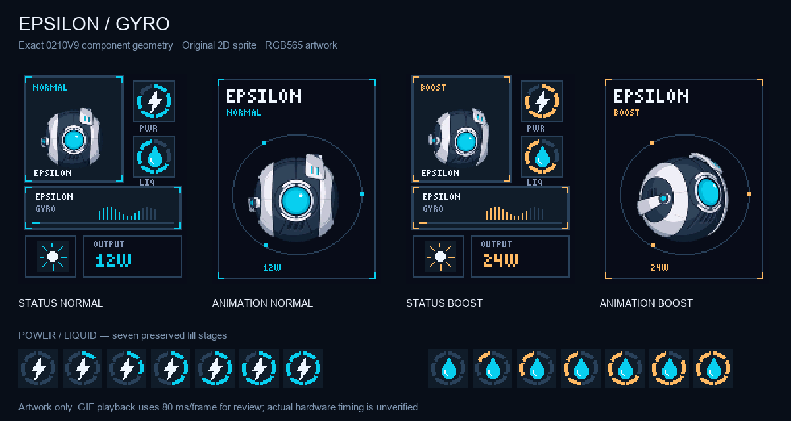

# Epsilon Gyro example artwork

Epsilon is an original floating orb character. This v2 theme uses the existing 2D sprite, cyan accents for Normal and amber for Boost. It covers every one of the 186 recovered bitmap slots, including both earlier duplicate brightness icons.

These PNGs and GIFs are **host-generated assets**. The earlier custom theme established the hardware method; Epsilon was subsequently installed on a [second device](../SECOND-DEVICE.md). Its owner confirmed the menu and puff animations in Normal and Boost, while exact on-device animation timing remains unmeasured.

## Files and encoding

- [manifest.json](manifest.json): offsets, dimensions, byte lengths, pixel-payload hashes, PNG paths and PNG hashes for all 186 images.
- `assets/`: 186 RGB565-quantized PNGs. Animation banks 1/2 correspond to Normal/Boost; each contains 42 frames. Status strips contain 32 frames per mode.
- [Offline v2 validation](../evidence/epsilon-v2-offline-verification.json): geometry, fill order, unchanged endpoints and comparison with Epsilon v1.
- [Display asset map](../ASSET-MAP.md): recovered storage and composition contract.

The original Epsilon export's slot aliases were renamed to neutral `animation-bank-1`, `animation-bank-2`, and `status-strip` names for publication. Pixel data is unchanged.

Each PNG must be encoded as row-major, opaque, big-endian RGB565 before use. The manifest's `rgb565_sha256` is the expected hash of that encoding, not of the PNG file. There is no per-image header or alpha channel. A 128 by 160 frame is 40,960 bytes. The [main writeup](../README.md) explains why replacement pixels belong in a copy of the device's own backup at the recovered offsets.

Epsilon v2 corrects the liquid ring to fill counterclockwise from the upper-left, matching the original stage order. Its ten intermediate liquid images differ from Epsilon v1 in 2,100 pixel bytes across sectors `0x01A000` through `0x01F000`; empty/full images and 172 non-liquid assets are unchanged. These offline counts are separate from the earlier theme's live six-sector update.

GIFs use 80 ms/frame for review. The existing firmware controls actual playback, mode, gauge selection and brightness state. Animated telemetry bars are decorative and do not add sensors or measurements.
